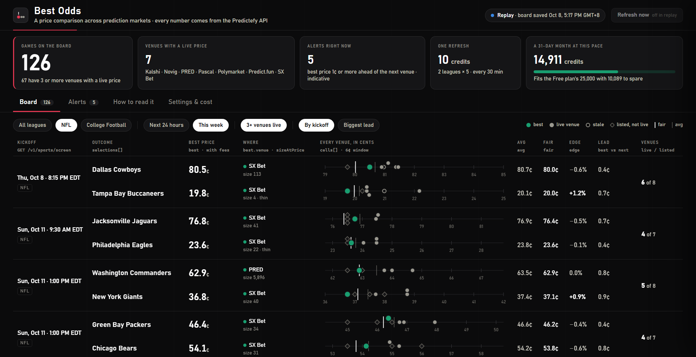

# Prediction Market Best Odds Bot

A small, read-only bot that lists upcoming games and, for each side, shows the best price on offer across Polymarket, Kalshi and the other prediction markets Predictefy covers: which venue has it, the average, the no-vig fair price, and how far the best price is ahead of the next venue.

It runs on your own computer, gets every number from the [Predictefy API](https://predictefy.com/en/api?utm_source=github&utm_medium=repo&utm_campaign=best-odds-bot&utm_content=github), and opens a local dashboard in your browser. It never places orders and never asks for a venue account or a wallet key.



> This is a price comparison. A gap between two venues is an indicative price difference, not arbitrage.

## What it does

1. Reads Predictefy's sports screen for each league you watch (NFL and College Football by default) every 30 minutes.
2. For each side of each game, shows Predictefy's `best`, `avg`, `fair`, `edge` and `hold`, and every venue's price on one short scale.
3. Works out the **lead**: the best price against the next venue's live price.
4. Prints an `ALERT` line, and lists it on the Alerts tab, when one venue is clearly ahead of the rest.
5. On request, loads a game's spread and total, and runs Predictefy's arbitrage check.

## Quick start

You need [Node.js](https://nodejs.org) 22 or newer and a Predictefy API key from [portal.predictefy.com/keys](https://portal.predictefy.com/keys). The Free plan is enough for the defaults.

```bash
git clone https://github.com/Ong-pogs/prediction-market-best-odds-bot
cd prediction-market-best-odds-bot
cp .env.example .env        # Windows PowerShell: Copy-Item .env.example .env
```

Open `.env`, paste your key after `PREDICTEFY_API_KEY=`, then start the bot:

```bash
node bot/server.mjs
```

Open the address it prints, `http://127.0.0.1:8817`. There is nothing to install: the bot uses only what ships with Node.

## Build it yourself

If you would rather have an AI coding tool write the bot from scratch, [`build-prompt.txt`](build-prompt.txt) is the full specification: the endpoints, the alert rule, the cost maths and the dashboard. Paste it into your AI coding tool in an empty folder.

## How to read the numbers

`best`, `avg`, `fair`, `edge` and `hold` are Predictefy's own calculations, returned by `GET /v1/sports/screen` ([sports guide](https://docs.predictefy.com/guides/sports/)). The bot shows them as returned and does not recompute them.

| Number | In plain words |
|---|---|
| Best | The cheapest live ask for that side, with fees when the venue's fee is known. Stale quotes and listed prices cannot win. |
| Avg | The plain average of the live asks across venues, before fees. The margin is still inside it. |
| Fair | The no-vig price: the averages for all sides, scaled so they add up to 100. |
| Edge | Fair divided by best, minus one. Above zero, the best price is cheaper than fair. It is usually a little below zero. |
| Hold | How far the averages add up past 100: the margin built into the prices. A big hold means a wide book. |

Prices are in cents on the dollar: a 20¢ price pays $1 if that side wins.

The bot adds two things of its own:

- **Lead**: the best price compared with the next venue's live price, in cents.
- **Alert**: the lead is 1¢ or more, at least 3 venues have a live price on that side, at least 25 contracts sit at the best price, and the game's hold is under 5%. Games where a side has no live ask, or where one venue is quoting far from the rest, never alert, because the average means little there.

## Is a gap arbitrage?

No. A gap on this board compares the top of each venue's book. It says nothing about depth beyond the size shown, and the venues' settlement rules can differ.

Only Predictefy's arbitrage feed, `GET /api/router/fetchArbitrage`, checks live asks, depth, fees and settlement rules together. The **Run the check** button on the Alerts tab calls it with `executableOnly=true` (15 credits) and marks any game on your board that has a row passing every gate. That feed is on the Pro plan and higher. On Free and Builder, Predictefy answers `403 PLAN_REQUIRED` and the dashboard shows where to upgrade; everything else keeps working.

## What it costs to run

| Call | Credits | When |
|---|---|---|
| `GET /v1/sports/screen` | 5 per league | every refresh |
| `GET /v1/sports/competitions` | 1 | once a day |
| `GET /v1/sports/fixtures/{id}` | 5 | when you load a game's spread and total |
| `GET /api/router/fetchArbitrage` | 15 | when you run the arbitrage check |

With the defaults, two leagues every 30 minutes is 10 credits a refresh, 481 credits a day and about 14,911 over a 31-day month. The Free plan has 25,000 credits a month. The Settings tab redoes this sum as you change the leagues or the interval and tells you which plan the new pace needs. With two leagues, the fastest refresh that still fits Free is every 18 minutes.

A league with more than 200 upcoming games takes a second page, which is another 5 credits.

## Settings

Change these on the dashboard's **Settings & cost** tab.

| Setting | Default | What it does |
|---|---|---|
| Leagues | NFL, College Football | Any league from Predictefy's list. Soccer leagues use the three-way match result |
| Refresh every | 30 minutes | How often the screen is read |
| Alert lead | 1¢ | How far under the next venue the best price must be |
| Venues needed | 3 | Venues with a live price on that side |
| Smallest size | 25 contracts | Size on offer at the best price |

Optional environment variables: `BEST_ODDS_PORT` (default `8817`), `BEST_ODDS_DATA` (the folder for saved state, default `data`) and `BEST_ODDS_REPLAY=1`, which shows the saved board without calling the API, so looking at it again costs no credits.

To see what Predictefy returns for one side of one game:

```bash
node bot/peek.mjs            # or: node bot/peek.mjs "Premier League"
```

## What it cannot tell you

- **It cannot tell you who wins.** The fair price is an average of market prices, not a prediction of its own.
- **The best price may be small.** The size shown is only what sits at that price. A bigger order moves down the book.
- **Coverage changes through the week.** Some venues only show a live price close to kick-off. Before that their price is "listed, not live" and cannot win best.
- **Fees are sometimes unknown.** Then the price shown is the bare ask and is labelled that way.
- **Team names come from Predictefy's catalogue.** College teams are listed by nickname.
- **It is not a betting recommendation**, and whether you may use a given venue depends on where you live.

## Tests

```bash
node --test
```

The tests run on real rows saved from the API in `bot/testdata/`.

## License

MIT. See [LICENSE](LICENSE).
